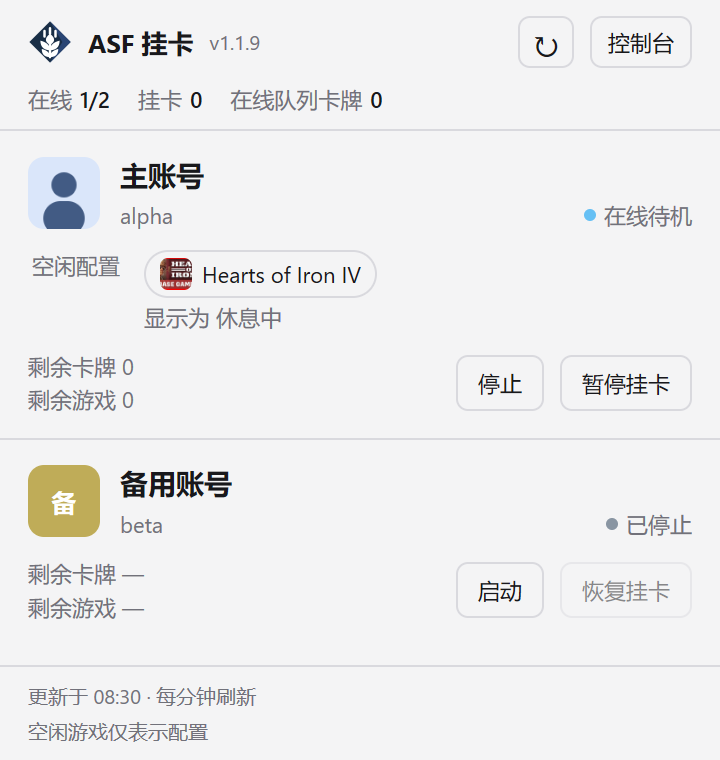
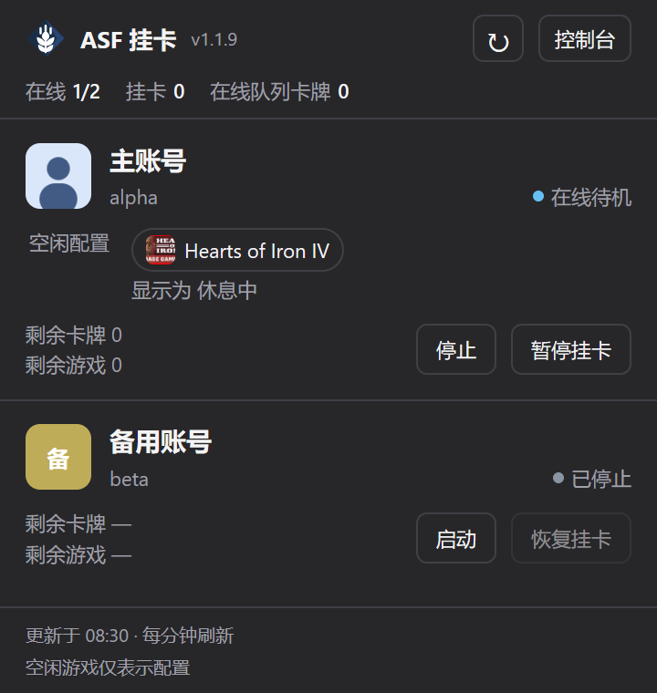

# ArchiSteamFarm

Metrix.Bar 中显示为 **ArchiSteamFarm**，版本 **1.1.9**；面板内使用紧凑简称 ASF 挂卡，标题旁直接显示版本号。已撤回 1.2.0 的 Steam 社区状态查询，保留 ASF 状态逻辑并优化窄窗口信息层级。

管理页、独立窗口和托盘统一使用深蓝菱形与白色麦穗图标，参考 [ASF 官方标识](https://github.com/JustArchiNET/ArchiSteamFarm/blob/main/resources/ASF_184x184.png) 重新绘制，简化细节以适配小尺寸。SVG 内嵌于 `.bar`，无需联网加载。可编辑原图：[icon.svg](icon.svg)。

## 连接

1. 先安装并运行 [ArchiSteamFarm](https://github.com/JustArchiNET/ArchiSteamFarm)，启用其 [IPC 服务](https://github.com/JustArchiNET/ArchiSteamFarm/wiki/IPC)。在 ASF 中配置 Steam 账号并完成登录或 Steam Guard 验证。
2. 将本目录的 `asf.bar` 导入 Metrix.Bar。
3. 在看板设置填写 **连接 · ASF IPC 地址**，默认 `http://127.0.0.1:1242`。填写源地址，不带 `/Api`、路径、查询参数或 URL 账号信息；本机允许 HTTP，远程服务使用 HTTPS。
4. 如 ASF 配置了 `IPCPassword`，在 **连接 · IPC 密码**填写相同值。这个 secret 字段保存于系统密钥库，不进入普通输入或本地存储。
5. 点击刷新图标。**控制台**按钮打开该服务的 ASF-ui。

看板只连接已运行的 ASF，不负责安装或启动 ASF 进程，不保存 Steam 密码，也不代替 ASF 登录流程。ASF 未启动、端口不同或访问配置拒绝时，面板显示连接错误。

## 状态与操作

- 托盘和顶部的挂卡数仅统计在线、运行中、未暂停且未被占用的卡牌农场；不把空闲挂游戏配置计入。顶部卡牌总数只合计在线机器人的农场队列，离线／停止机器人的队列显示 `—`。
- 账号行显示 Steam 头像、昵称、ASF 账号名、状态、当前卡牌挂卡游戏、剩余游戏和卡牌数。头像使用 ASF 的 `AvatarHash` 从 `avatars.steamstatic.com` 加载，不发送 IPC 密码；缺失、无效、加载中或加载失败时显示昵称缩写。
- 「卡牌挂卡」内容区仅在账号在线、运行中、未暂停、未被游戏占用且 ASF 报告正在挂卡时显示。待机、暂停、停止、未连接和游戏占用时隐藏，并同步缩短窗口；空闲配置、队列计数及账号控制按钮保留，恢复挂卡后自动重新显示。
- 状态灯直接依据 ASF 返回：在线待机浅蓝、卡牌挂卡绿色、停止灰色、连接／暂停／占用黄色；保留状态文字，不仅依赖颜色。
- 分别显示卡牌农场与 `GamesPlayedWhileIdle` 空闲游戏配置。每个游戏使用独立胶囊，包含 16 DIP 游戏封面缩略图与名称，多游戏自动换行；长名称在胶囊内单行截断，悬停查看全文和 App ID。空闲游戏名称与两类游戏封面从 Steam 商店读取，名称优先简体中文；卡牌游戏名称优先使用 ASF 返回值。图片缺失、加载中或失败时，原生 Avatar 显示名称缩写；商店不可用时空闲游戏保留 `App ID`。
- 游戏元数据按 App ID 去重并缓存在当前 Worker 内存，连接变更或重启后重新查询。图片仅接受声明的 Steam HTTPS CDN 与对应游戏路径，不向商店或图片服务发送 IPC 密码。预览中游戏封面来自 Steam 商店，版权归各游戏权利人。
- 窗口默认宽度 360 DIP，左右留白 14 DIP。顶部第一行显示 22 DIP ASF logo、名称、版本、刷新图标与控制台按钮，第二行紧凑显示在线账号、挂卡账号和在线队列卡牌。刷新为 28×26 DIP 图标按钮，控制台同高，均保留悬停提示与禁用状态。账号使用 36 DIP 圆角头像，昵称独占一行，ASF 账号名与状态在下一行。当前卡牌游戏使用独立背景区域及绿色侧线；空闲配置单独标注。窗口按游戏数量预留高度，最多 680 DIP，更多账号在单层列表内滚动。
- 空闲配置不代表实际运行。ASF 能报告当前卡牌农场游戏、连接、暂停与占用，但其标准接口不提供空闲游戏运行确认；不要求公开 Steam 资料。
- **启动／停止**控制账号运行。启动成功后可能仍需等待登录；停止会断开该账号。
- **暂停挂卡／恢复挂卡**只控制卡牌农场。暂停发送 `Permanent: true, ResumeInSeconds: 0`，持续至手动恢复或 ASF 重启，不设自动恢复计时。
- 每分钟自动刷新；顶部刷新图标为面板唯一刷新按钮，也可按 Ctrl/Cmd+R 或使用托盘刷新。底部显示 24 小时制更新时间与配置说明。打开面板时超过一分钟未更新会触发刷新。空账号不显示统计区，连接失败单独显示原因；刷新失败保留旧数据并标记过期。

操作只针对所在行的账号。ASF 将 `ASF`、`@...`、`r!...`、逗号和 `..` 解释为选择器；此类名称在看板中仅展示，控制需转到 ASF 管理页。请求执行中禁用控制，防止重复点击。

接口返回成功后重新读取状态；“ASF 已接受”不等于账号已经登录。操作未确认或后续读取失败时，保留最后已知状态并标记过期；先刷新核对，再进行下一次操作。连接地址、密码改变或 Worker 停止会取消请求并隔离旧结果，但已到达 ASF 的控制请求无法撤销。

缺失的游戏／卡牌字段显示 `—`，不会当作零。账号、游戏和响应仅保存在内存，刷新失败保留同一连接最后成功的数据与时间。鉴权头只发送到配置的源地址，拒绝重定向；不显示远端原始错误正文。

## 预览

以下为隔离示例数据，不包含真实账号。

| 浅色 | 深色 |
| --- | --- |
|  |  |

## 接口与验证

使用 `GET /Api/Bot/ASF`，以及 `POST /Api/Bot/{账号名}/Start`、`Stop`、`Pause`、`Resume`。非空 IPC 密码通过 `Authentication` 请求头传递。

已核对本机 ASF 的 OpenAPI：`IsConnectedAndLoggedOn`、`IsPlayingPossible`、`CardsFarmer.NowFarming`／`Paused`／`CurrentGamesFarming` 是当前状态；`BotConfig.GamesPlayedWhileIdle` 是配置。官方 [`status` 实现](https://github.com/JustArchiNET/ArchiSteamFarm/blob/main/ArchiSteamFarm/Steam/Interaction/Commands.cs)同样读取连接、占用、暂停和卡牌农场，不提供空闲游戏确认。`IsPlayingPossible` 只表示允许游戏，不能等同正在运行。看板不查询 Steam 社区在线状态；Steam 商店仅用于游戏名称和封面。

```sh
bun test tests/asf/asf.test.js
bun run build
```

- `tests/asf/asf.test.js`：控制后的服务端状态、业务拒绝、刷新失败、缺失字段、连接／密码变更隔离、重复操作、账号选择器边界、空闲配置与卡牌农场区分、离线队列及头像 URL 验证。
- `tests/asf/fixtures/accounts.json`：原生深浅色截图数据。
- `tests/asf/fixtures/controls.json`：`fixture` 和 `steps` 可传入本机 `/v0/check`，连同 `.bar` 源码及 `scheduled: true`，验证四步原生控制。

1.1.9 已通过 14 项行为测试（98 项断言）、单游戏和多游戏原生明暗预览及四步隔离控制。覆盖长名称、无图缩写、图片与游戏 ID 配对、拒绝跨游戏／外部图片 URL、元数据缓存和连接变更隔离。图片 404 负向检查保留游戏名称，原生资源检查按预期报告加载错误；此错误场景不生成截图。未操作真实账号启停。

界面参考官方 [GitHub Repository](https://metrix.bar/dashboards/github-repo.bar) 的紧凑顶部栏与单层滚动组织；业务代码独立实现，未嵌入 ASF 源码或第三方库。许可为仓库的 AGPL-3.0-only。
