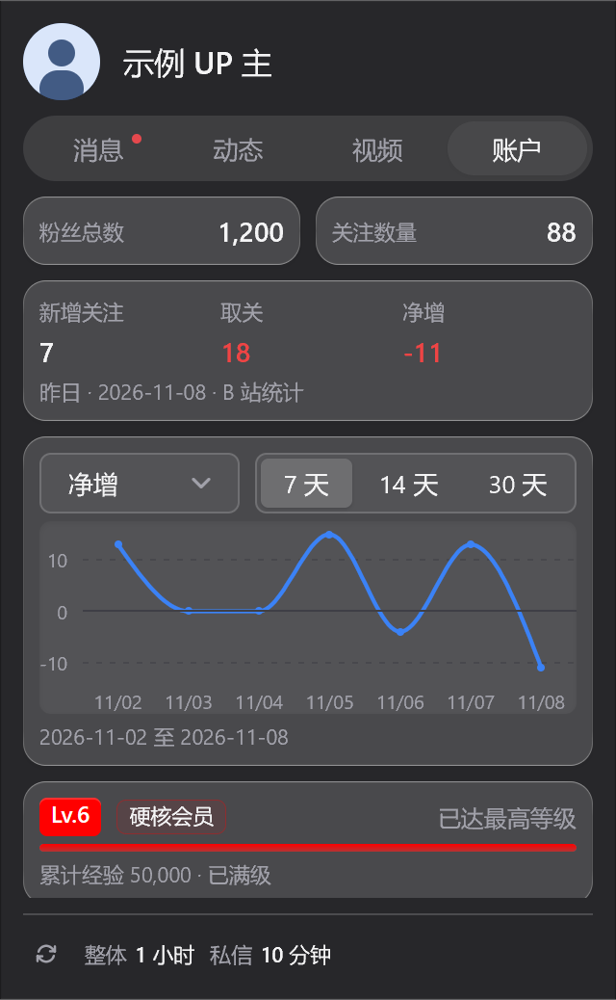

# BiliBili

[下载当前源码](bilibili-account.bar) · [看板源索引](../../registry/index.json) · **1.19.0（2026-11-11）**

在 Metrix.Bar 中查看账户、投稿、消息与动态。整体自动刷新间隔可自定义，默认 **1 小时**；私信独立刷新，默认 **10 分钟**。

## 安装与登录

1. 从看板源安装，或下载上方 `.bar` 源码后导入 Metrix.Bar。
2. 打开看板，点击 **扫码登录**，用 **哔哩哔哩 App → 扫一扫** 扫描二维码。
3. 在手机上确认登录，看板会保存凭据并加载账户数据。

二维码有效期为 3 分钟，超时后点击 **重新生成**；等待扫码或手机确认时可取消。点击头像或在看板右键菜单选择重新扫码，即可切换账户。二维码在本机生成，凭据保存在系统密钥库，无需开发者工具或手动复制 Cookie。

已有凭据可使用 **高级 · SESSDATA（可选）**，填写要求见下方设置。看板源安装 ID 为 `vofficial404--bilibili-account`；直接导入或本地 API 安装 ID 为 `bilibili-account`。两种实例分别保存凭据，直接导入不建立看板源更新关联。

## 页面与操作

| 页面／入口 | 内容 |
| --- | --- |
| 消息 | 未读私信、可选最近会话、回复、@、赞、系统通知、UP 主助手及对应网页入口 |
| 动态 | 登录账户的动态流、作者筛选、手动加载更多；点击条目打开原文 |
| 视频 | 最近 3／5／10 条自己作为主投稿者的公开视频，封面、五项统计及采样变化 |
| 账户 | UID、硬币、等级与经验、硬核会员身份、粉丝与关注、昨日新增关注／取关／净增、7／14／30 天粉丝趋势 |
| 菜单栏／托盘 | 粉丝总数、昨日净增（含零）、页面快捷入口、刷新和打开私信 |

顶部仅显示头像和昵称；头像加载失败时显示昵称缩写。底部显示刷新频率，并提供面板内唯一的刷新按钮。悬停频率区可查看完整说明与各项最近更新时间；关闭消息页或未读私信后隐藏私信频率。手动刷新也可通过右键菜单、托盘菜单或 `Ctrl/Cmd+R` 执行。Windows 托盘用图标与提示显示数据，macOS 菜单栏可直接显示标题。

默认页面顺序为 **消息 → 动态 → 视频 → 账户**，启动打开首个可用页面。多个页面时显示标签栏，单页时隐藏；重排保留当前页面，停用当前页则切换到首个可用页。全部停用时隐藏页面菜单并显示设置提示，头像、昵称、登录校验与刷新仍保留。只看视频时关闭其他三页，只看账户时同理。

界面自动跟随系统明暗主题，并遵循“减少动态效果”设置。UID 与硬币仅在账户页显示，硬核会员标识位于等级旁；长 UID 可悬停查看。视频大数字使用“万／亿”，悬停可查看完整值；点击视频、消息卡片或动态条目打开对应网页。

面板使用 Metrix.Bar 原生 Glass 材质，根容器不绘制实色背景以保留系统材质；账户卡片采用带主题底色的玻璃、细描边和轻阴影，图表绘图区保留清晰底色。硬核会员使用淡红底描边徽章，等级保留 B 站配色。保留紧凑尺寸与窗口自动收紧。

更新后关闭并重新打开面板，新的宿主材质才会生效。按 [Metrix.Bar 材质契约](https://metrix.bar/docs/components#panel-material)，macOS 弹出面板可使用系统 popover／Vibrancy；Windows 等环境由宿主提供 Glass 或回退效果。组件 Glass 仅采样同窗口内容，不能直接模糊桌面，不等同于承诺 Windows Acrylic／Mica。原生预览验证明暗主题和可读性，不能证明桌面透视效果；macOS 实机未验证。

## 按需开启功能

在 Metrix.Bar 原生看板设置中调整，分组顺序为 **全局 → 排序 → 账户 → 视频 → 消息 → 动态 → 高级登录**。**20 个功能开关默认全部开启**；以下表格中的页面开关与细分开关均适用。设置在重启和源码更新后保留，停用页面会停止相关可选请求并保留细分选择。

<details>
<summary><strong>全局</strong> · 自定义整体刷新间隔</summary>

**全局 · 刷新间隔（分钟）**（`global_refresh_minutes`）可填写 **1–1440 的整数**，默认 **60**。例如 `15` 为每 15 分钟，`90` 为每 90 分钟，`120` 为每 2 小时；清空或超出范围时使用 60 分钟。

设置保存后更新所有已启用模块，并采用新的自动间隔。底部频率和悬停说明同步显示有效值，整数小时以小时显示。反复打开面板不会重置倒计时；重启后沿用保存的设置。私信独立刷新频率不受此字段影响，但整体刷新本身仍会更新已开启的私信。

</details>

<details>
<summary><strong>排序</strong> · 数字越小越靠前</summary>

| 设置项 | 字段 | 默认值 |
| --- | --- | --- |
| 排序 · 消息 | `order_messages` | 10 |
| 排序 · 动态 | `order_dynamic` | 20 |
| 排序 · 视频 | `order_videos` | 30 |
| 排序 · 账户 | `order_account` | 40 |

例如将视频改为 `15`，顺序变为消息 → 视频 → 动态 → 账户。同值按默认页面顺序排列；支持零和负整数，清空或无效值回退该页默认值。停用页面跳过排序，重新开启后恢复原位置；填回 `10、20、30、40` 即恢复默认排列。排序变更会停止切页动效。

</details>

<details>
<summary><strong>账户页</strong> · UID／硬币、粉丝／关注、等级／经验</summary>

| 设置项 | 控制内容 |
| --- | --- |
| 账户 · 启用账户页 | `show_account`：账户页及托盘粉丝统计；关闭后停止粉丝请求 |
| 账户 · UID 与硬币 | UID、硬币余额 |
| 账户 · 粉丝与关注 | 粉丝总数、关注数量、昨日新增关注／取关／净增、粉丝趋势图、托盘粉丝数 |
| 账户 · 等级与经验 | 等级、累计经验、升级进度、硬核会员标识 |

总开关关闭或三个细分选项全部关闭时隐藏账户页，头像、昵称与登录校验仍保留。关闭粉丝功能后，账户窗口会按剩余内容进一步收紧。

在同一“账户”分组中调整尺寸，保存后生效，重启与更新后保留：

| 设置项 | 选项／范围 | 默认值 |
| --- | --- | --- |
| 账户 · UID 与硬币尺寸 | 紧凑／正常／宽松 | 紧凑 |
| 账户 · 粉丝与关注尺寸 | 紧凑／正常／宽松 | 紧凑 |
| 账户 · 昨日统计尺寸 | 紧凑／正常／宽松 | 紧凑 |
| 账户 · 等级与经验尺寸 | 紧凑／正常／宽松 | 紧凑 |
| 账户 · 曲线高度 | 80–240，整数逻辑像素，仅绘图区 | 100 |
| 账户 · 窗口高度上限 | 280–900，整数逻辑像素 | 560 |

四个模块独立调整；紧凑模式保留全部统计，粉丝／关注标签与数值同行，昨日三项并排并在下方标注“昨日”和日期。正常／宽松模式的昨日统计为三行。图表指标与天数控件同排；曲线高度独立于模块尺寸与窗口上限。账户窗口随已开启模块、模块尺寸、曲线高度及标签栏自动收紧，不为关闭的模块预留空白；超过设置上限时在账户页内滚动，底部刷新入口保持可见。实际窗口可以小于 280，280 是可填写上限的最小值。高度清空或越界时使用默认值；这些设置不改变统计口径、菜单顺序或其他页面尺寸。

</details>

### 粉丝趋势

账户页保留昨日新增关注、昨日取关、昨日净增及统计日期，下方趋势图默认显示 **7 天、净增**。天数可选 **7／14／30 天**，指标可选 **新增关注／取关／净增**。切换只使用已加载数据，不发起网络请求；托盘仍显示粉丝总数和昨日净增。

图表始终以**北京时间昨日**为结束日期，显示完整起止日期和逐日横轴；悬停数据点可查看 **YYYY-MM-DD 完整日期与人数**。净增只在同一天的关注和取关数据都存在时计算。缺失日期保留空缺，不补零，也不跨空缺连线；数据不完整时显示覆盖情况，窗口内没有有效点时显示暂无数据。

天数与指标偏好保存到本机，重启后恢复有效选择；保存成功才应用，失败时保留原选择并提示。趋势数据仅留在当前 Worker 内存。关闭账户页或粉丝功能后隐藏图表和相关错误、停止请求并清除趋势数据；切换账户会清除数据、错误和采样时间，旧请求的响应不会写回新账户界面。

<details>
<summary><strong>视频页</strong> · 投稿数量、封面与统计</summary>

| 设置项 | 控制内容／默认值 |
| --- | --- |
| 视频 · 启用视频页 | 页面总开关；关闭后停止视频请求 |
| 视频 · 最近投稿数量 | 3／5／10 条，默认 **5 条** |
| 视频 · 封面 | 缩略图；关闭后停止加载封面图片 |
| 视频 · 发布时间 | 标题下方的发布时间 |
| 视频 · 播放量 | 播放统计 |
| 视频 · 点赞数 | 点赞统计 |
| 视频 · 收藏数 | 收藏统计 |
| 视频 · 投币数 | 被投币统计 |
| 视频 · 评论数 | 评论统计 |

封面在左、标题在右，统计位于下方；每项已启用统计的数值下显示一行采样变化。关闭统计项会调整显示列，全部细项关闭后仍保留可点击标题。各项共享视频详情请求，作者验证和投稿排序仍需读取详情。

</details>

<details>
<summary><strong>消息页</strong> · 私信、最近会话与五类通知</summary>

| 设置项 | 控制内容／默认值 |
| --- | --- |
| 消息 · 启用消息页 | 页面总开关；关闭后停止消息请求 |
| 消息 · 未读私信 | 未读私信卡片、私信入口与可选会话列表 |
| 消息 · 私信展示方式 | `private_display`：统计卡片（`summary`，默认）／会话列表（`list`） |
| 消息 · 最近会话数量 | `private_count`：3／5／10 个，默认 **5 个** |
| 消息 · 会话卡片尺寸 | `private_card_size`：紧凑（`compact`）／正常（`normal`，默认） |
| 消息 · 私信刷新频率 | `private_refresh`：5 分钟／**10 分钟（默认）**／30 分钟／1 小时／6 小时 |
| 消息 · 收到的赞 | 点赞通知 |
| 消息 · 回复我的 | 回复通知 |
| 消息 · @ 我的 | @ 通知 |
| 消息 · 系统通知 | 系统通知 |
| 消息 · UP 主助手 | 助手消息 |

私信独立请求，其余五类通知共享接口，至少启用一类才请求。全部细项关闭后隐藏消息页；单卡片占整行，多个通知使用双列布局。回复与 @ 的合并计数仅在两项都开启时显示。

**最近会话**仅在消息页、未读私信均启用且展示方式为 `list` 时请求；默认统计模式不请求会话列表或用户资料。列表模式先显示最近私信，再显示已启用的通知，同时保留未读私信总数。卡片包含对方头像、昵称、UID、最后一条消息摘要、时间和未读数，点击打开该用户的网页私信会话。正常尺寸最多显示两行摘要，紧凑尺寸为一行；悬停可查看完整预览。关闭列表或切换账户会清除会话内存。

**未读红点**位于消息标签文字右上角，出现和消失不改变文字居中位置；单页模式在页内标题右上角提示。会话未读数使用居中的紧凑圆角标记，保留完整数量。红点只统计已启用类型，不计拦截私信；回复／@ 仅有合并计数时，要求两项都开启。切页或打开会话不会清除红点，也不发送已读确认。成功刷新返回零后消失，失败保留上次成功状态；关闭对应类型或切换账户后不沿用旧提醒。

</details>

<details>
<summary><strong>动态页</strong> · 作者筛选与加载更多</summary>

**动态 · 启用动态页**（`show_dynamic`）默认开启，验证登录账户后才请求动态流。关闭后停止请求并清除内存中的动态与错误。头像、作者与时间同排，正文在下方占满内容宽度，最多三行；点击整条打开原文，长昵称可悬停查看完整昵称与 UID。筛选栏、列表与分页统一左右留白，筛选栏和底部分页固定，中间列表独立滚动。作者筛选页使用同样的左右边距，筛选控件与候选用户共用一层滚动。

默认显示所有作者。点击 **筛选** 进入作者筛选页，可按昵称或 UID 搜索已加载动态的发布者并勾选，也可输入十进制 UID 直接添加，最多保存 **100 个 UID**。点击 **返回动态** 查看结果。

| 筛选模式 | 行为 | 空选择时 |
| --- | --- | --- |
| 全部 | 显示所有已加载动态 | 显示全部 |
| 仅显示所选作者 | 仅显示选中 UID 的动态 | 无结果 |
| 排除所选作者 | 隐藏选中 UID 的动态 | 显示全部 |

选择立即保存并作用于已加载内容，不额外请求网络，也不改变服务器动态流；转发按转发者筛选。已选作者即使不在当前列表中也会保留，缺少昵称时显示 UID；清空选择只清除所选 UID。无效输入或保存失败会提示，未保存的筛选不会显示为已生效。

没有结果时可手动 **加载更多** 查找更早动态，最多保留 **100 条**并去重。支持视频、图文、专栏、图片及文字摘要；转发仅展开一层原动态，其他类型保留类型提示与原文入口 `https://t.bilibili.com/{动态 ID}`。

筛选模式和 UID 按已验证账户分别保存在本机，切换账户不混用；动态内容、作者资料、搜索词和待添加 UID 仅在内存中，切换账户时清空。

</details>

<details>
<summary><strong>高级登录</strong> · 可选 SESSDATA</summary>

**高级 · SESSDATA（可选）** 默认无需填写，扫码即可登录。手动使用现成凭据时，只填 SESSDATA 的值，保留百分号编码，不粘贴整段 Cookie。

</details>

### 旧版迁移

1.13.0 将整体自动刷新从 6 小时调整为 **1 小时**，私信默认值、五档频率和已保存配置不变。1.10.0 已移除 `menu_order`、`show_tab_bar`，更早的 `navigation:v1` 本地菜单配置也不再读取；旧版自定义顺序需改用四个排序数字，既有页面开关与其他原生设置继续有效。顶部仅保留头像、昵称，页面切换统一使用标签栏，刷新统一放在底部；菜单与快捷键入口保留。

1.14.0 新增全局刷新分钟数，未设置时继续使用 60 分钟；私信的默认值、可选间隔及已保存选择不变。

1.15.0 将粉丝“较上次净变化”替换为 B 站创作中心的昨日统计，托盘同步显示昨日净增。旧粉丝采样基线不再读取或更新；视频采样方式不变。沿用当前扫码登录凭据和既有网络权限，无需重新配置。

1.16.0 新增粉丝趋势选择器，首次默认 7 天、净增，随后恢复本机保存的有效展示偏好。保留 1.15.0 的昨日摘要和托盘口径，不恢复旧粉丝采样基线，也不持久化趋势数据。

1.17.0 新增账户模块尺寸、曲线高度与窗口高度设置。升级后未设置的新项使用紧凑模块、100 高曲线和 560 高窗口；可在原生看板设置的“账户”分组调整，原有天数与指标选择继续保留。

1.17.1 将“窗口高度”改为“窗口高度上限”，保留字段 `account_panel_height` 及已保存的值。窗口按当前内容自动收紧，修复关闭 UID／硬币等模块后等级区下方的多余留白。

通过看板源升级时，如提示新增权限，需确认创作中心 `member.bilibili.com` 和三个图片 CDN 域名 `i0/i1/i2.hdslb.com`。遇到 `registry: SHA256 mismatch` 时，先在看板源设置中刷新索引再重试，不要跳过摘要校验。

## 刷新与数据口径

| 触发方式 | 更新范围 |
| --- | --- |
| 整体自动刷新，按全局分钟数设置，默认每 1 小时 | 所有已启用模块 |
| 启动、原生设置变更、手动刷新 | 所有已启用模块；图表天数／指标切换不触发刷新 |
| 私信独立定时刷新，默认每 10 分钟 | 未读私信；列表模式同时更新会话及所选用户资料，不更新五类通知、动态或其他指标 |

私信计时器仅在消息页和未读私信均开启时运行；Worker 启动、重新开启私信或调整私信频率后重新计时。单独修改全局刷新间隔不改写私信配置，也不取消正在进行的私信请求。关闭任一开关或 Worker 停止会清理计时器并取消请求，账户与相关功能配置变更会隔离旧响应，同时触发的私信刷新合并处理。自动刷新需要应用运行且看板 Worker 活跃，休眠和退出会影响实际采样时间。

| 数据 | 口径与限制 |
| --- | --- |
| 昨日粉丝统计 | 从创作中心 `/x/web/data/v2/fans/stat/num?period=-1` 读取 `follow`（新增关注）、`unfollow`（取关）和 `log_date`（统计日期）；昨日净增为这两个服务端计数之差，不使用本地两次粉丝总数差，也不把 `all_fans` 当净增。以北京时间昨日为准，显示统计日期；服务端数据延迟时显示“昨日统计暂不可用”和最近统计日期，数值显示 `—`。同日请求失败保留本次会话已取得的昨日数据并提示错误，跨日后不继续冒充昨日；重启重新读取，不保存粉丝基线。 |
| 粉丝趋势 | 每次刷新在验证账户后顺序请求创作中心 `/x/web/data/v2/fans/stat/graph?type=follow&period=1` 和 `type=unfollow&period=1`，各一次获取月度数据，再在本地显示 7／14／30 天窗口。读取 `data.tendency` 的北京时间零点 Unix 秒时间戳 `date_key` 和非负安全整数 `total_inc`，按日期排序对齐；同日关注减取关得到净增，只有一侧数据时不计算该日净增。空数组有效，非法日期、重复日期、今日／未来日期或非法计数视为请求失败。两项都成功才替换整组，任一失败保留上次整组并显示独立趋势错误，不影响总数及昨日摘要。 |
| 等级经验 | 累计经验、升级目标与本级进度；Lv.6 显示满级并保留累计经验。仅 `is_senior_member=1` 显示硬核会员，普通大会员不计入。 |
| 视频范围 | 从已登录创作中心 `member.bilibili.com/x/web/archives?status=pubed` 发现公开稿件，按发布时间排序并核对详情中的主投稿者 UID，过滤其他 UP 主发布的联合投稿。沿用密钥库 SESSDATA，无需 API key；评论数不含弹幕，封面取 `pic`，缺失时保留标题和统计。 |
| 视频变化 | 播放、点赞、收藏、投币、评论分别对比同 UID、同 BVID 的上次成功采样。首次 `—`、增长 `+`、下降负号、零变化 `0`；失败不推进，不把缺失值当零，也不是固定日增量。仅持久化当前所选视频的数值基线和采样时间。 |
| 未读私信 | 已关注与未关注用户未读数之和；拦截私信单列，推送、客服、粉丝团不混入合计。回复、@、赞为未读通知数，缺失显示 `—`。 |
| 最近会话 | 按会话时间倒序显示最近 3／5／10 个一对一会话，过滤群聊、系统、拦截及自己，校验最后一条消息双方 UID。用户资料按 UID 匹配，缺失昵称时显示实际 UID；会话未读数不替代私信总数。 |
| 会话摘要 | 发出的内容带“我：”，图片和表情显示类型标签，撤回显示 `[消息已撤回]` 且不展示原文；空消息为“暂无消息内容”，损坏或不支持内容显示明确提示。 |
| 动态流 | 使用 `https://api.bilibili.com/x/polymer/web-dynamic/v1/feed/all?type=all`，加载更多附加分页游标。省略 `visible:false`，动态 ID 保留十进制字符串；分页去重、拒绝重复或不前进的游标，并合并并发加载。首页刷新成功才替换列表，失败保留内容并显示分项错误；停用、凭据变更或 Worker 停止会取消请求并隔离旧结果。 |

各项失败独立保留当前会话上次成功数据，显示错误与采样时间。私信未读数和会话列表分别记录状态，会话失败不妨碍未读数更新。B 站网页接口可能因接口变更、风控或登录过期不可用；登录过期时重新扫码。看板不会自动续期登录。

## 隐私与权限

| 存储位置 | 保存内容 |
| --- | --- |
| 系统密钥库 | 登录凭据 |
| Metrix.Bar 原生设置 | 页面排序、开关及其他设置 |
| 普通本地存储 | 按 UID／BVID 隔离的当前视频数值基线与采样时间；按账户隔离的动态筛选模式与 UID；`follower-chart:v1` 仅保存图表 `{days,metric}` 偏好。旧版粉丝采样键不再读取或更新 |
| Worker 内存 | 账户详情、粉丝总数、昨日统计与趋势数据、视频标题与图片、会话对方身份与消息内容、动态正文与作者资料、搜索词与输入草稿；不跨重启保存 |

头像来自账户接口 `face`；头像和封面仅从 `i0/i1/i2.hdslb.com` 通过 HTTPS 加载，不附加登录 Cookie。二维码在本机生成。看板**不会发送私信、调用已读确认或标记消息已读**；打开会话仅跳转到 B 站网页。

## 预览

以下均使用合成的隔离示例数据，由 Metrix.Bar 原生渲染。账户浅色／深色预览为 1.19.0 的 Glass 材质卡片、内嵌趋势图与等级徽章（关闭 UID／硬币）；预览不包含桌面背景。动态与筛选预览为 1.14.2，紧凑会话预览为 1.14.1：

| 账户（浅色） | 账户（深色） |
| --- | --- |
|  |  |

| 动态（浅色） | 动态（深色） | 作者筛选 |
| --- | --- | --- |
|  |  |  |

| 紧凑会话（浅色） | 紧凑会话（深色） |
| --- | --- |
|  |  |

<details>
<summary><strong>其他页面示例</strong> · 历史版本截图</summary>

以下保留各页面的内容与配置示例，按钮位置和刷新频率可能与当前版本不同；当前界面以顶部预览和正文说明为准。

| 视频（深色） | 消息（浅色） |
| --- | --- |
|  |  |

| 视频仅保留播放／评论 | 消息仅保留收到的赞 |
| --- | --- |
|  |  |

| 最近会话（浅色） | 最近会话（深色） |
| --- | --- |
|  |  |

| 扫码登录（浅色，示例二维码） | 扫码登录（深色，示例二维码） |
| --- | --- |
|  |  |

</details>

## 开发

维护约定见 [AGENTS.md](../../AGENTS.md)。源码、用户说明、第三方声明与预览集中在本目录；行为测试与隔离响应位于 `tests/bilibili/`。应用内保留简短登录提示和本 README 入口。

安装 [Bun](https://bun.sh/) 后，在仓库根目录按改动范围选择检查：

```sh
bun test tests/bilibili/account.test.js
bun test tests/registry.test.js
bun test
bun run build
```

构建器基于 Metrix.Bar 官方工具，支持 Windows 目录分隔符和看板子目录，生成 `registry/index.json` 及完整 SHA-256 命名的看板副本。旧发布文件保留，避免旧索引下载到新内容。业务变化提升 SemVer，并提交源码与新增构建产物；纯文档维护不升版。保持看板 ID，`.gitattributes` 固定 LF。

本地 Metrix.Bar 使用 `POST /v0/validate` 和 `POST /v0/check` 验证，组件契约以运行中应用的 `GET /v0/types` 为准；检查 `valid`、`diagnostics`，HTTP 200 不代表通过。

| 原生交互场景 | `tests/bilibili/fixtures/` 中的文件 |
| --- | --- |
| 账户、导航与功能开关 | `account.json`、`navigation.steps.json`、`features.steps.json` |
| 粉丝趋势指标、7／14／30 天切换及停用／恢复 | `account.json`、`follower-trend.steps.json` |
| 最近会话 | `conversations.json`、`conversations.steps.json`；仅含合成消息，复用现有图片资源 |
| 扫码登录 | `login.json`、`login.steps.json` |

<details>
<summary><strong>原生界面约定</strong> · 布局、等级色与动效</summary>

界面使用 `.bar` 原生组件和系统悬停、焦点、主题样式。账户信息栏左侧为 UID、右侧为硬币余额，数字使用等宽字形；粉丝总数与关注数量并排，昨日三项按行显示并标注日期，取关及负净增使用错误色，正净增使用成功色。视频五项统计保留列宽，变化量单行显示。会话昵称与时间同排，摘要旁显示未读数，UID 位于下方；紧凑模式缩小头像、间距与内边距。消息区为滚动条保留空间。动态头像为 24 DIP，条目用细线分隔。

等级色沿用 [B 站官方网页等级图标](https://s1.hdslb.com/bfs/seed/laputa-header/bili-header.umd.js)：Lv.0／1 `#C0C0C0`、Lv.2 `#8BD29B`、Lv.3 `#7BCDEF`、Lv.4 `#FEBB8B`、Lv.5 `#EE672A`、Lv.6 与硬核会员 `#FF0000`。标识白字，经验条跟随等级色。

| 交互 | 参数 |
| --- | --- |
| 标签滑块、页面切换 | 250ms；页面位移 8 DIP、模糊 3 DIP |
| 按压 | 150ms；刷新按钮缩放 0.97，其他卡片 0.99 |
| 等级进度条 | 400ms |
| 刷新图标 | 500ms 一圈；点击 900ms 后用 500ms 复位 |
| 登录面板 | 入口 320×208 DIP，二维码展开 320×432 DIP，错误／过期 320×240 DIP |
| 二维码 | 212 DIP，黑码白底并保留静区；250ms、4 DIP 淡入，重新生成可重播 |

动效曲线为 `cubic-bezier(0.22, 1, 0.36, 1)`，仅动画期间更新帧。“减少动态效果”开启后，页面与进度直接显示最终状态，并停用缩放、旋转、二维码淡入；偏好变更立即生效。

</details>

## 参考与许可证

- [B 站扫码登录接口](https://sessionhu.github.io/bilibili-API-collect/docs/login/login_action/QR.html)
- [账户信息](https://sessionhu.github.io/bilibili-API-collect/docs/login/login_info.html#导航栏用户信息)
- [视频查询](https://sessionhu.github.io/bilibili-API-collect/docs/video/collection.html#根据关键词查找视频) · [视频详情](https://sessionhu.github.io/bilibili-API-collect/docs/video/info.html#获取视频详细信息-web端)
- [未读私信](https://github.com/chenshd/bilibili-api-collect/blob/main/docs/message/private_msg.md#获取未读私信数)
- [动态流接口与字段](https://github.com/pskdje/bilibili-API-collect/blob/main/docs/dynamic/all.md)
- [创作中心接口参考包 bilibili-api-python 17.4.2](https://pypi.org/project/bilibili-api-python/17.4.2/)：`creative_center` 粉丝概览；本项目独立实现，`follow`／`unfollow` 已经登录账号与对应趋势接口交叉验证，测试和预览仅用合成数据。

看板使用 [AGPL-3.0-only](../../LICENSE)。原生界面组织参考同许可证的官方 [github-repo.bar](https://metrix.bar/dashboards/github-repo.bar)。内嵌 qrcode-generator 1.4.4 使用 MIT 许可证，声明见 [第三方许可证](THIRD_PARTY_NOTICES.md)。本项目与哔哩哔哩无官方关联。
