# BiliBili

[下载当前源码](bilibili-account.bar) · [看板源索引](../../registry/index.json) · 1.12.0（2026-11-10） · 整体每 6 小时刷新 · 私信默认每 10 分钟刷新

## 登录

1. 安装并打开看板，点击 **扫码登录**。
2. 打开手机上的 **哔哩哔哩 App → 扫一扫**，扫描看板内的二维码。
3. 在手机上确认登录。看板自动保存登录凭据并加载账户数据。

二维码有效期为 3 分钟。超时后点击 **重新生成**；等待扫码或手机确认时可以取消。连接后点击头像，或在看板右键菜单选择重新扫码，即可切换账户。

登录凭据保存在 Metrix.Bar 的系统密钥库，二维码在本机生成。无需打开开发者工具或复制 Cookie。有现成凭据时可在看板设置中填写 **高级 · SESSDATA（可选）**：只填其值，保留百分号编码，不要粘贴整段 Cookie。

## 功能

| 页面 | 内容 |
| --- | --- |
| 消息 | 未读私信、可选最近会话卡片、回复、@、赞、系统通知、UP 主助手及对应网页入口 |
| 视频 | 最近 3／5／10 条自己作为主投稿者的公开视频；显示封面及播放、点赞、收藏、投币、评论数与各项采样变化 |
| 账户 | 真实头像、昵称、UID、硬币余额、等级与累计经验、硬核会员身份、升级进度、粉丝与关注数量、粉丝净变化 |
| 动态 | 已登录账户的动态流、作者筛选与手动加载更多；点击卡片打开动态原文 |
| 菜单栏／托盘 | 粉丝总数、非零净变化、刷新和打开私信操作 |

自动跟随系统明暗主题。可点击 **刷新** 或按 `Ctrl/Cmd+R` 手动更新。Windows 托盘通过图标与提示显示数据；macOS 菜单栏可直接显示标题。

标签页默认从左到右为 **消息 → 动态 → 视频 → 账户**，启动时打开已保存顺序中最靠前的可用页面。在 Metrix.Bar 原生看板设置中，通过四个 **排序** 数字调整位置，通过各页的 **启用…页** 控制页面开关。小组件顶部只保留头像、昵称和刷新按钮，页面切换统一使用标签栏；多个页面开启时始终显示标签栏，只有一个页面时自动隐藏。重排保留当前页面；当前页停用时切换到最靠前的可用页面，全部停用时显示设置提示。

设置由 Metrix.Bar 保存，重启和源码更新后保留。停用页面会停止该页的可选请求，保留细分选择；排序变更会终止切页动效。1.10.0 移除了排列下拉框 `menu_order` 和标签栏开关 `show_tab_bar`；旧版自定义排列请改用排序数字设置，既有页面开关及其他原生设置继续有效。更早的 `navigation:v1` 本地菜单配置不再读取。

真实头像与昵称在所有标签页常驻，头像加载失败时回退为昵称缩写。UID 与硬币余额仅在账户页显示：独立圆角信息栏左侧弱化 UID，右侧以硬币图标和加重数字显示余额；数字使用等宽字形，长 UID 省略显示并可悬停查看完整值。其他页面的顶部保留头像、昵称与刷新按钮。刷新间隔只在底部显示。账户页用宽卡片显示粉丝数，硬核会员标识放在等级旁；视频采用左侧封面、右侧标题，下方保留五项统计，每项已启用统计的数值下以一行小字显示变化量，保持五列宽度；消息卡片点击后打开对应页面。视频大数字使用“万／亿”显示，悬停可查看完整数值。

## 按需开启功能

在 Metrix.Bar 的看板设置中调整选项，表单依次排列为 **排序 → 账户 → 视频 → 消息 → 动态 → 高级登录**。展开下面对应页面查看说明；20 个功能开关默认全部启用。

<details>
<summary><strong>排序</strong> · 数字越小越靠前</summary>

| 设置项 | 字段 | 默认值 |
| --- | --- | --- |
| 排序 · 消息 | `order_messages` | 10 |
| 排序 · 动态 | `order_dynamic` | 20 |
| 排序 · 视频 | `order_videos` | 30 |
| 排序 · 账户 | `order_account` | 40 |

只需修改要移动的页面，例如把视频改为 `15`，顺序就是消息 → 视频 → 动态 → 账户。相同数字按消息、动态、视频、账户的默认先后排列；支持零和负整数，清空某项时该页使用默认值。停用的页面自动跳过，重新开启后仍使用其排序值。恢复默认排列时填回 `10、20、30、40`。

</details>

<details>
<summary><strong>账户页</strong> · UID／硬币、粉丝／关注、等级／经验</summary>

| 设置项 | 控制内容 |
| --- | --- |
| 账户 · 启用账户页 | `show_account`：账户页总开关，同时控制托盘粉丝统计；关闭时停止粉丝请求并保留三项细分选择 |
| 账户 · UID 与硬币 | 账户页的 UID 和硬币余额 |
| 账户 · 粉丝与关注 | 粉丝总数、净变化、关注数量与托盘粉丝数 |
| 账户 · 等级与经验 | 等级、经验进度和硬核会员标识 |

关闭账户页总开关，或三项细分选项全部关闭后，隐藏账户页；若其他页面也关闭，则保留设置提示。头像、昵称与登录校验继续保留。

</details>

<details>
<summary><strong>视频页</strong> · 页面开关、投稿数量、封面与统计</summary>

先开启 **视频 · 启用视频页**，再选择需要展示的内容。关闭页面会停止视频请求，并保留细分选择。

| 设置项 | 控制内容 |
| --- | --- |
| 视频 · 最近投稿数量 | 最近 3／5／10 条投稿，默认 5 条 |
| 视频 · 封面 | 缩略图；关闭后停止加载封面图片 |
| 视频 · 发布时间 | 标题下方的发布时间 |
| 视频 · 播放量 | 播放统计 |
| 视频 · 点赞数 | 点赞统计 |
| 视频 · 收藏数 | 收藏统计 |
| 视频 · 投币数 | 被投币统计 |
| 视频 · 评论数 | 评论统计 |

统计列自动重排，全部细项关闭后仍保留可点击的标题。视频详情由各项共享，作者验证和投稿排序仍需要读取详情。

</details>

<details>
<summary><strong>消息页</strong> · 页面开关、私信展示与刷新、五类通知</summary>

先开启 **消息 · 启用消息页**，再勾选消息类型。关闭页面会停止消息请求，并保留细分选择。

| 设置项 | 控制内容 |
| --- | --- |
| 消息 · 未读私信 | 未读私信卡片、私信入口与可选会话列表 |
| 消息 · 私信展示方式 | `private_display`：统计卡片（`summary`，默认）或会话列表（`list`） |
| 消息 · 最近会话数量 | `private_count`：最近 3／5／10 个会话，默认 5 个 |
| 消息 · 会话卡片尺寸 | `private_card_size`：紧凑（`compact`）／正常（`normal`，默认） |
| 消息 · 私信刷新频率 | `private_refresh`：5 分钟、10 分钟（默认）、30 分钟、1 小时或 6 小时 |
| 消息 · 收到的赞 | 点赞通知卡片 |
| 消息 · 回复我的 | 回复通知卡片 |
| 消息 · @ 我的 | @ 通知卡片 |
| 消息 · 系统通知 | 系统通知卡片 |
| 消息 · UP 主助手 | 助手消息卡片 |

私信独立请求；其余五类通知共享接口，至少启用一类时才请求。全部细项关闭后隐藏消息页，单卡片使用整行宽度。回复与 @ 合并计数仅在这两项都开启时显示。

消息标签有未读时显示红点；只开启消息页、没有标签栏时，在页内标题显示红点。红点只统计已开启的私信和通知类型，不计拦截私信；回复／@ 仅有合并计数时要求两项都开启。打开页面或点击会话不会本地清除红点，也不发送已读确认；下一次成功刷新返回零后消失，失败时保留上次成功状态。关闭对应类型或切换账户后不沿用旧提醒。

选择最近会话时，同时保留未读私信总数和已启用的其他通知卡片。会话卡片显示对方头像、昵称、UID、最后一条消息摘要、时间与未读数；点击后打开该用户的 B 站网页私信会话。会话列表仅在消息页、未读私信均启用且展示方式为 `list` 时请求；默认汇总模式不请求会话列表或用户资料。关闭列表或切换账户会清除内存中的会话数据。

会话列表使用轻量行布局，昵称与时间同排，摘要右侧显示红色未读数量，UID 保留在下方。正常尺寸保留两行摘要；紧凑尺寸缩小头像、间距和内边距，摘要单行截断。悬停摘要可查看完整预览，两种尺寸都能点击打开会话。通知入口改为标签与数量同行的紧凑双列布局，有未读的数量使用红色强调；列表模式下先显示最近私信，再显示通知入口。

消息区域右侧保留滚动条空间，避免未读总数、卡片未读标记和时间与滚动条重叠。

私信定时刷新请求未读私信接口；最近会话模式还会更新会话列表与所选用户资料，不刷新五类通知或其他指标。消息页和未读私信均启用时才运行；启用 Worker、重新开启私信或调整配置后重新计时。关闭任一开关或 Worker 停止时清理计时器并取消在途请求，账户与配置变更隔离过期响应，同时触发的私信刷新合并处理。需要应用运行且看板 Worker 活跃；休眠和退出会影响实际刷新时间。

</details>

<details>
<summary><strong>动态页</strong> · 页面开关、作者筛选与加载更多</summary>

**动态 · 启用动态页**（`show_dynamic`）默认开启。只有验证登录账户后才请求动态流；在原生设置中关闭后停止请求并清除内存中的动态及错误。

动态页使用紧凑列表：24 DIP 头像、同排作者与时间、最多三行正文，条目之间用细分隔线区分；整条可点击打开原文。长昵称单行截断，悬停可查看完整昵称与 UID。筛选栏和底部条数／加载更多固定，中间列表独立滚动。

默认显示所有作者的动态。点击 **筛选** 进入独立的作者筛选子页面，可选择 **全部／仅显示所选作者／排除所选作者**。按昵称或 UID 搜索当前已加载动态的发布者，勾选需要的作者；也可直接输入十进制数字 UID 添加，最多保存 100 个。点击顶部 **返回动态** 查看结果，选择立即保存且返回时保留。无效输入会在界面提示。已选作者即使不在当前动态中也会保留，没有昵称时回退为 UID；清空选择只清除所选 UID。仅显示模式下空选择不显示动态，排除模式下空选择显示全部。

筛选立即作用于已加载内容，不额外请求网络，也不改变服务器返回的动态流。转发按转发者筛选，而非原作者。筛选后没有结果时，可手动 **加载更多** 查找更早的动态；最多保留 100 条，重复动态不会重复展示。列表支持视频、图文、专栏、图片及文字摘要；转发只展示一层原动态摘要，其他类型提供类型提示及原文入口。点击条目打开 `https://t.bilibili.com/{动态 ID}`。

筛选模式与所选 UID 按已验证的登录账户分别保存在本机，切换账户不会混用。动态内容、作者资料、搜索词与待添加 UID 只保存在内存；切换账户清空动态和输入状态。偏好保存失败会显示提示，不将未保存的筛选显示为已生效。

</details>

<details>
<summary><strong>高级登录</strong> · 已有 SESSDATA 时使用</summary>

默认在看板内扫码登录即可。**高级 · SESSDATA（可选）** 只用于手动填写现成凭据：仅填其值、保留百分号编码，不粘贴整段 Cookie。

</details>

只看视频：关闭账户页、消息页与动态页；只看账户：关闭视频页、消息页与动态页。只剩一个页面时隐藏标签栏，精简账户模式自动收紧面板。全部页面关闭时隐藏页面菜单并显示设置提示。头像、昵称、登录校验与刷新始终保留。

应用内只保留简短登录提示和本 README 链接。

## 数据口径

- **粉丝变化**：本次成功采样减去上次成功采样，包含掉粉。首次建立基线；按 UID 保存在本机，失败不推进基线，重启后保留。悬停净变化卡片可查看对比时间，不表示固定日增量或新增关注人数。
- **等级经验**：显示累计经验、升级目标和本级进度。Lv.6 显示满级并保留累计经验；只有账户接口 `is_senior_member=1` 时显示“硬核会员”，不把普通大会员当作硬核会员。等级标识沿用 [B 站官方网页等级图标](https://s1.hdslb.com/bfs/seed/laputa-header/bili-header.umd.js) 的色值：Lv.0／1 `#C0C0C0`、Lv.2 `#8BD29B`、Lv.3 `#7BCDEF`、Lv.4 `#FEBB8B`、Lv.5 `#EE672A`、Lv.6 与硬核会员 `#FF0000`；标识为白字，经验条跟随等级色。
- **视频统计**：由已登录创作中心 `member.bilibili.com/x/web/archives?status=pubed` 发现稿件，按发布时间排序，只展示公开状态并核对详情中的主投稿者 UID，过滤其他 UP 主发布的联合投稿；评论数不含弹幕。封面来自视频详情 `pic`，缺失时仍显示标题和统计。该请求沿用密钥库中的 SESSDATA，不需要 API key；由看板源更新时需确认新增的创作中心域名权限。
- **视频变化**：播放、点赞、收藏、投币、评论分别与同一 UID、同一 BVID 的上次成功采样比较；首次显示 `—`，增长带 `+`、下降带负号，零变化显示 `0`。失败保留原基线，不将缺失值当作零；这不是固定日增量。重启后只恢复当前所选视频的数值计数与采样时间，按 UID／BVID 隔离；不持久化标题、封面或凭据。
- **未读私信**：已关注与未关注用户的未读数之和。拦截私信单列，推送、客服和粉丝团不混入合计。回复、@、赞为未读通知数；缺失值显示 `—`。
- **最近会话**：按会话时间倒序显示最近 3／5／10 个一对一会话，过滤群聊、系统、拦截与自己的会话，并校验最后一条消息的双方 UID。用户资料按 UID 匹配，缺失昵称时仍显示实际 UID。发出的摘要带“我：”；图片和表情显示类型标签，撤回消息显示 `[消息已撤回]`，不展示撤回原文；空消息显示“暂无消息内容”，损坏或不支持的内容显示明确提示。会话未读数不替代未读私信总数。
- **动态流**：使用 `https://api.bilibili.com/x/polymer/web-dynamic/v1/feed/all?type=all`，手动加载更多时附加分页游标；只展示接口允许显示的条目，省略 `visible:false`。动态 ID 全程保留十进制字符串，避免大整数精度损失。首次刷新成功才替换列表，失败保留当前列表并显示动态分项错误；分页去重并拒绝重复或不前进的游标，同时触发的加载更多合并处理。停用、凭据变更或 Worker 停止会取消请求，过期结果不得写回。
- **刷新**：整体自动间隔仍为 6 小时；私信使用独立的 `private_refresh`，默认 10 分钟，可选 5 分钟、30 分钟、1 小时或 6 小时。启动、设置变更及手动刷新仍更新所有已启用模块。独立私信计时器更新未读数，最近会话模式还更新会话及用户资料，不请求动态或五类通知；应用运行且看板 Worker 活跃时才执行，休眠和退出会影响实际采样时间。
- **失败保留与存储**：各项独立保留当前会话的上次成功数据，显示失败原因与采样时间；未读私信与会话列表分别记录错误和采样时间，会话失败不妨碍未读数成功更新。菜单偏好统一由 Metrix.Bar 原生输入保存。普通本地存储跨重启保存粉丝采样、当前所选视频的数值基线和采样时间、按账户隔离的动态筛选模式与 UID。视频标题、图片、账户详情、会话对方身份与消息内容、动态正文和作者资料只保存在 Worker 内存，登录凭据只保存在系统密钥库。
- **图片权限**：头像来自账户接口 `face`；头像和封面只从 B 站图片 CDN `i0/i1/i2.hdslb.com` 通过 HTTPS 加载，不向图片请求附加登录 Cookie。由看板源更新时需确认新增的三个图片域名权限。

B 站网页接口可能因接口变更、风控或登录过期而不可用。登录过期时重新扫码即可。看板不会发送私信、调用已读确认接口或标记消息已读，也不会自动续期登录。

## 界面与动效

这是 `.bar` 原生组件界面。标签滑块和页面切换为 250ms，页面位移 8 DIP、模糊 3 DIP；按压为 150ms，刷新按钮缩放到 0.97，其他卡片到 0.99；等级进度条为 400ms。刷新图标 500ms 旋转一圈，点击 900ms 后用 500ms 复位。

登录入口为 320×208 DIP，生成真实二维码后展开为 320×432 DIP，错误或过期时为 320×240 DIP。主操作随明暗主题调整，扫码期间可取消或重新生成。212 DIP 二维码固定黑码白底并保留静区，出现时以 250ms、4 DIP 淡入，重新生成可重播。

动效使用 `cubic-bezier(0.22, 1, 0.36, 1)`。仅在动画期间更新帧；系统开启“减少动态效果”时，页面与进度直接显示最终状态，停用缩放、旋转及二维码淡入，偏好变更立即生效。悬停颜色、焦点环与主题颜色沿用原生系统样式。

## 预览

以下使用隔离示例数据，由 Metrix.Bar 原生渲染。

| 账户（浅色） | 视频（深色） | 消息（浅色） |
| --- | --- | --- |
| 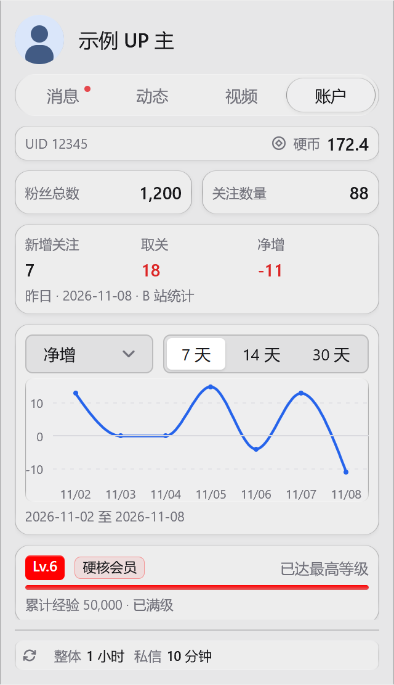 | 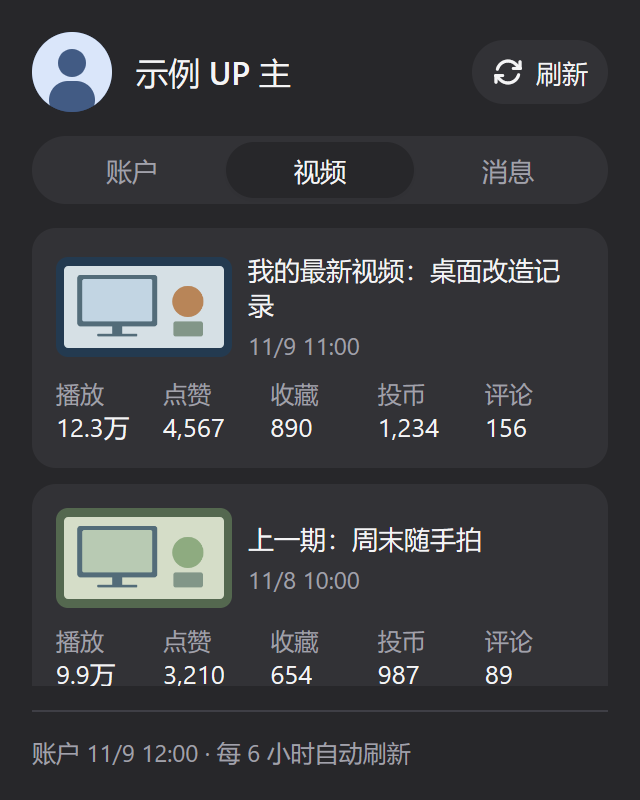 | 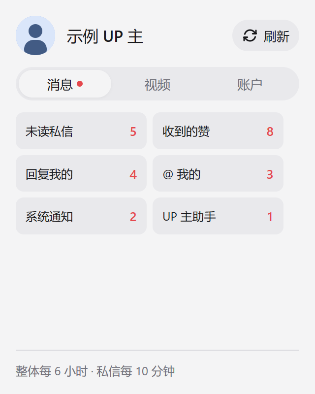 |

[账户深色预览](previews/account-dark.png)

| 动态（浅色） | 动态（深色） | 作者筛选 |
| --- | --- | --- |
| 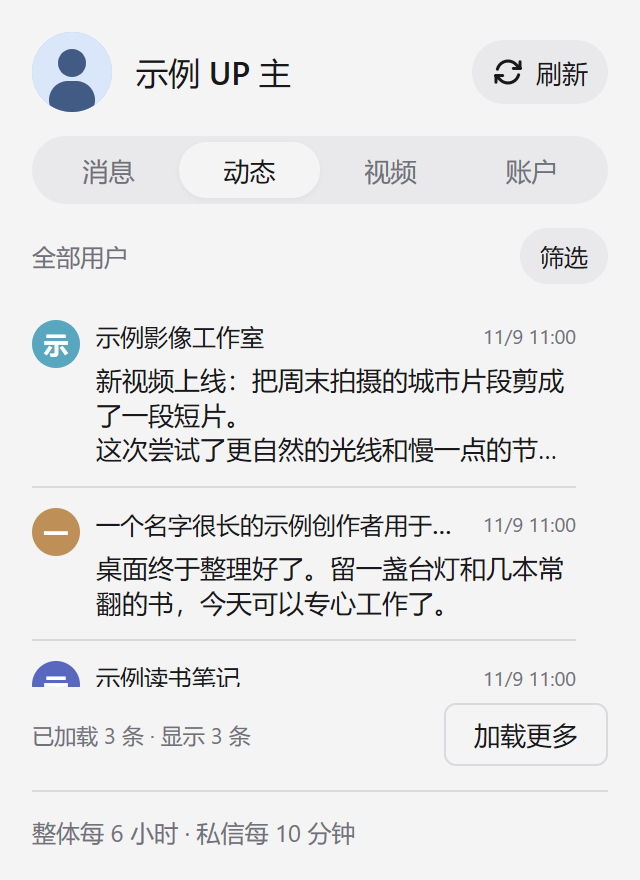 | 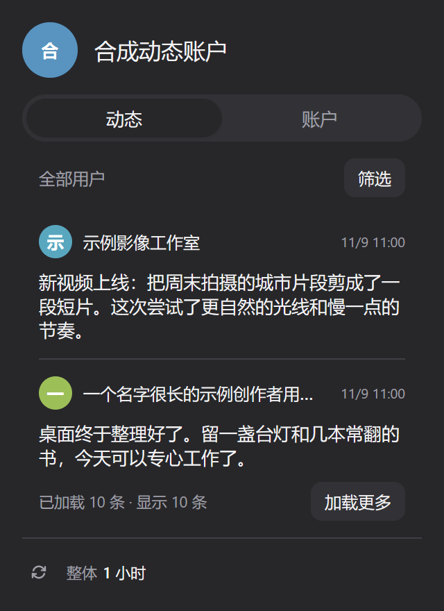 | 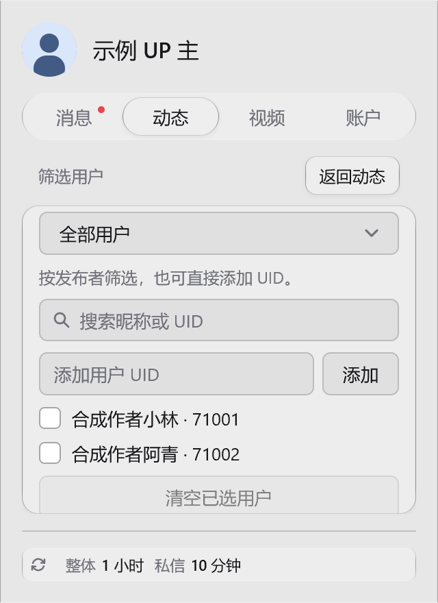 |

| 视频仅保留播放／评论 | 消息仅保留收到的赞 |
| --- | --- |
| 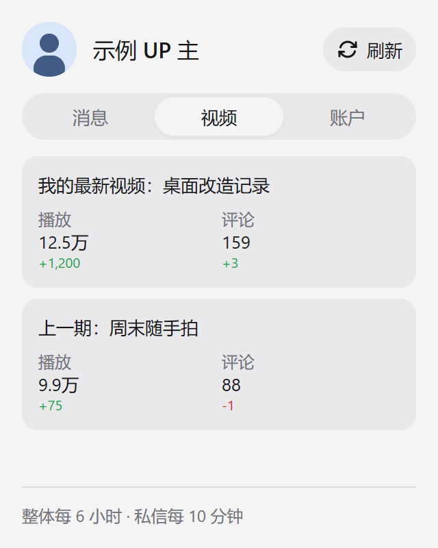 | 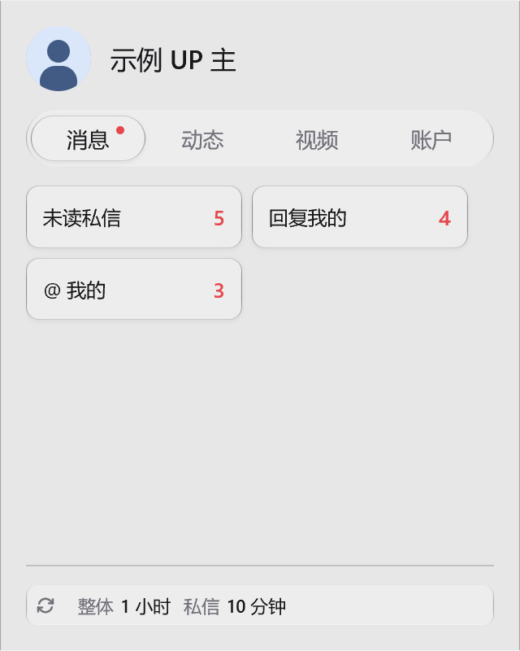 |

| 最近会话（浅色） | 最近会话（深色） |
| --- | --- |
| 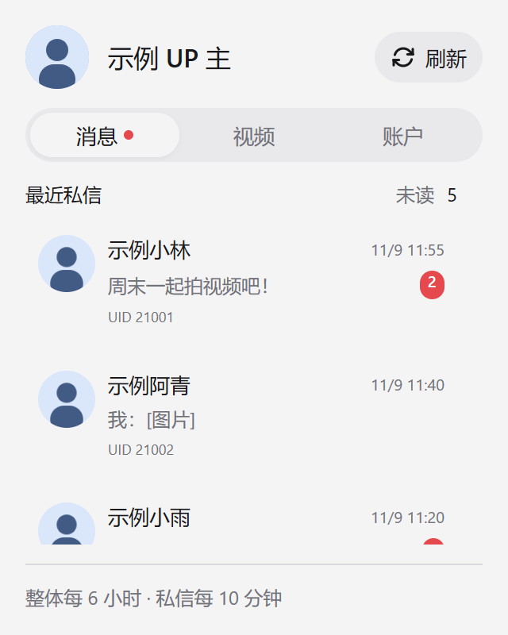 | 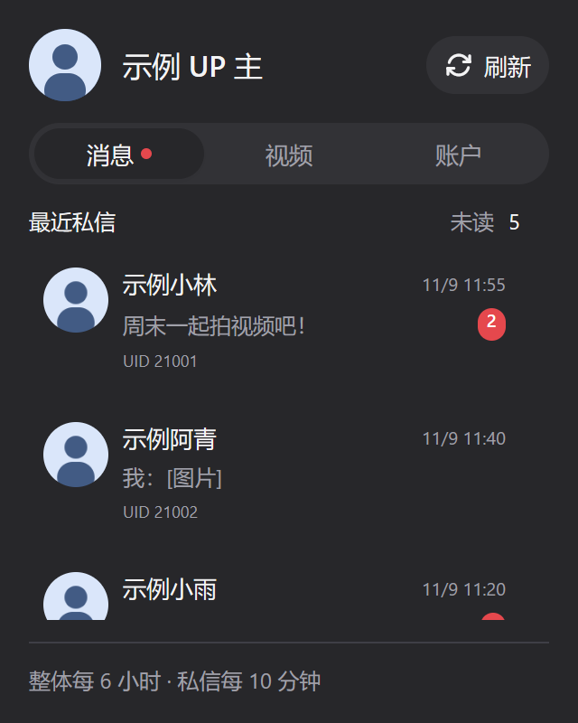 |

| 紧凑会话（浅色） | 紧凑会话（深色） |
| --- | --- |
| 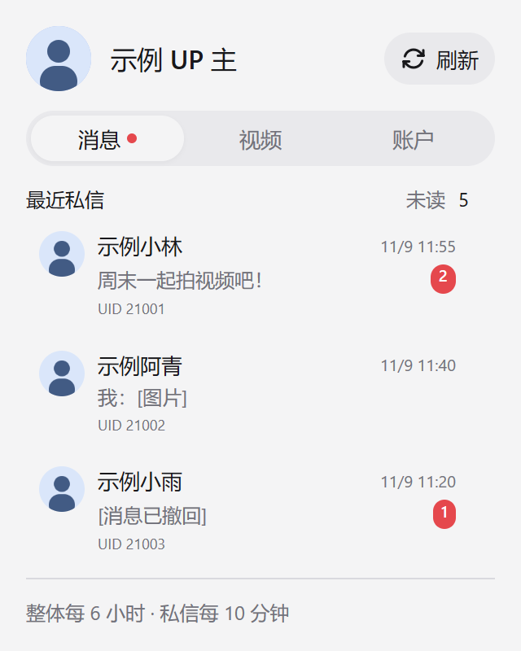 | 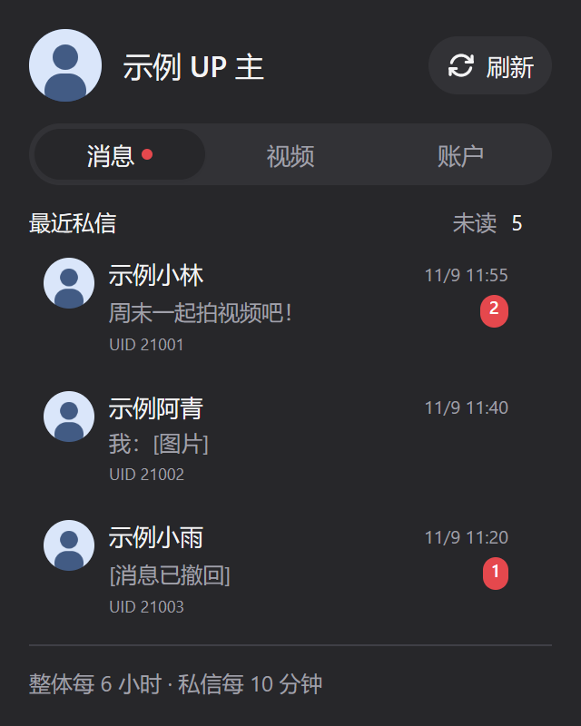 |

| 扫码登录（浅色，示例二维码） | 扫码登录（深色，示例二维码） |
| --- | --- |
|  |  |

## 开发

维护约定见 [AGENTS.md](../../AGENTS.md)。源码、用户说明、第三方声明与预览集中在本目录，行为测试与隔离响应位于 `tests/bilibili/`。

安装 [Bun](https://bun.sh/) 后，在仓库根目录运行：

```sh
bun test tests/bilibili/account.test.js
bun test tests/registry.test.js
bun test
bun run build
```

构建器基于 Metrix.Bar 官方工具，已规范化 Windows 目录分隔符以支持看板子目录。它会生成 `registry/index.json` 和以完整 SHA-256 命名的看板副本；旧文件保留，避免旧索引下载到新内容。业务变化时提升 SemVer，提交源码与新增构建产物；纯文档维护不提升版本。保留看板 ID，`.gitattributes` 固定 LF 换行。若遇到 `registry: SHA256 mismatch`，先在看板源设置中刷新索引再重试，不要跳过摘要校验。

本地 Metrix.Bar 还需通过 `POST /v0/validate` 和 `POST /v0/check` 验证，组件契约以连接中应用的 `GET /v0/types` 为准。原生交互场景使用 `tests/bilibili/fixtures/` 内的 `account.json`、`navigation.steps.json`、`features.steps.json`；最近会话场景使用 `conversations.json` 与 `conversations.steps.json`，仅含合成消息并复用现有图片资源；登录场景使用 `login.json` 与 `login.steps.json`。检查结果须确认 `valid` 和 `diagnostics`，HTTP 200 不代表通过。

通过看板源安装的实例 ID 是 `vofficial404--bilibili-account`；本地 API 或直接导入的实例 ID 是 `bilibili-account`。两者的登录凭据独立，直接导入不建立看板源更新关联。

## 参考与许可证

- [B 站扫码登录接口](https://sessionhu.github.io/bilibili-API-collect/docs/login/login_action/QR.html)
- [账户信息](https://sessionhu.github.io/bilibili-API-collect/docs/login/login_info.html#导航栏用户信息)
- [视频查询](https://sessionhu.github.io/bilibili-API-collect/docs/video/collection.html#根据关键词查找视频) · [视频详情](https://sessionhu.github.io/bilibili-API-collect/docs/video/info.html#获取视频详细信息-web端)
- [未读私信](https://github.com/chenshd/bilibili-api-collect/blob/main/docs/message/private_msg.md#获取未读私信数)
- [动态流接口与字段](https://github.com/pskdje/bilibili-API-collect/blob/main/docs/dynamic/all.md)

看板使用 [AGPL-3.0-only](../../LICENSE)。原生界面组织参考同许可证的官方 [github-repo.bar](https://metrix.bar/dashboards/github-repo.bar)。内嵌的 qrcode-generator 1.4.4 使用 MIT 许可证，声明见 [第三方许可证](THIRD_PARTY_NOTICES.md)。本项目与哔哩哔哩无官方关联。
