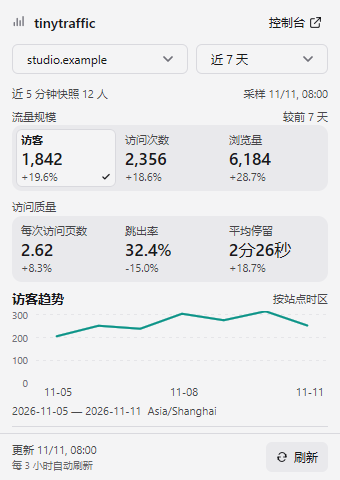
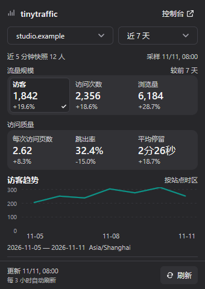

# tinytraffic

面向 [tinytraffic](https://github.com/egoist/tinytraffic) 的 Metrix.Bar 网站流量看板。当前正式版本 **1.0.0**，通过 [VOfficial404 看板源](../../registry/index.json)提供安装与后续更新。

默认采用 340 × 480 DIP 的紧凑布局：顶部第一行固定显示 tinytraffic 图标、标题和控制台入口，第二行是站点与时间范围；长站点名截断，悬停显示完整域名。滚动内容依次为活跃快照、两组指标、所选指标趋势及可筛选排行。访客／访问次数／浏览量归为“流量规模”，每次访问页数／跳出率／平均停留归为“访问质量”。参考 [Transitions.dev 的 Tabs sliding](https://transitions.dev/library.html) 中共用底槽与中性选中表面的层次，每组指标使用连续圆角背景，取消六张独立描边卡片及大面积蓝色选中底。当前项用主题表面、细轮廓、加粗标签及勾选标记区分，辅助标签明确“已选中”；切换时只有一项标记，趋势标题同步。勾选位置固定预留，切换不挤动数字。辅助文字和未选中标签使用主题正文色的 78% 不透明度。变化值及排行条采用中性色，强调色主要用于无填充折线；趋势区由 72 DIP 图表和 16 DIP 日期行组成，日期最多显示首、中、末三项，并保留完整日期和时区提示。指标按钮仅在键盘焦点下显示焦点描边，保留悬停与按压反馈。不复制网页 CSS 或滑动动画；原生主题背景过渡曾在深色预览中出现浅色闪帧，因此未启用。左右留白 12 DIP，标题及刷新栏上下留白 8 DIP；指标通常三列，窄窗口换行。明暗主题随系统切换，内容采用单层滚动，标题、日期选择和底部刷新栏固定。

滚动区域采用原生悬浮圆角滑块，不额外占用内容宽度；滑块位置向内 2 DIP，上下各留 4 DIP，连接页与统计页一致。参考 macOS 的轻量滚动处理，保留原生拖动和滚轮操作。当前 Metrix.Bar 未开放独立滑块宽度、颜色或淡出动画配置，外观由宿主主题决定。[窄窗口滚至最后一项的原生预览](previews/scroll-bottom-narrow.png)使用临时 `scrollIntoView` 验证，正式源码不自动跳到底部；截图不证明鼠标悬停和淡出动画。

## 安装与连接

1. 按[仓库安装说明](../../README.md#安装)添加看板源，在源中安装 **tinytraffic**。也可直接导入本目录的 [tinytraffic.bar](tinytraffic.bar)；直接导入实例独立保存配置，不与公开看板源建立更新关联。
2. 在自己的 tinytraffic 服务中打开 **Account → API keys**，创建 **Read only** 密钥。
3. 在看板设置填写完整服务源地址及 API Key。地址示例为 `https://stats.example.com`，不包含 `/api` 路径；本机开发服务支持 `http://127.0.0.1:8080`、`localhost` 或 `[::1]`。非本机服务使用 HTTPS。
4. 点击刷新。连接成功后会读取有权访问的全部站点，默认选择第一个或上次选中的有效站点。

API Key 通过 Metrix.Bar 的 secret 输入保存到系统密钥库。不要将真实密钥写入 `.bar`、fixture、README 或聊天记录。没有配置密钥时只显示连接说明，不发送 API 请求。右上角“控制台”按钮带外链图标，悬停显示目标站点；点击后在浏览器打开当前站点控制台，未选站点时打开服务首页。连接页、空站点页和托盘菜单采用相同跳转语义，浏览器登录由 tinytraffic 自己处理。

| 设置 | 默认值 | 行为 |
| --- | --- | --- |
| 连接 · tinytraffic 服务地址 | `http://127.0.0.1:8080` | 使用 tinytraffic 公共 `/api/v1` 接口 |
| 连接 · 只读 API Key | 空 | `Authorization: Bearer …`；仅发送读取请求，不跟随重定向 |
| 刷新 · 间隔（分钟） | 180（3 小时） | 支持 1–1440 的整数；清空、非整数或越界时回退 180 分钟 |
| 展示 · 排行条数 | 5 | 可选 5、10、20 条；超过窗口高度时滚动 |

默认每 **3 小时**自动刷新。在看板设置的“刷新 · 间隔（分钟）”中填写自定义时长，保存后生效并由应用持久保存；底部显示当前有效间隔。调整间隔不会清除站点、筛选或已加载数据。调度仅在 Worker 启动或有效间隔变化时更新，重绘不会推迟下一次刷新。底部按钮、托盘菜单或 **Ctrl/Cmd+R** 可随时手动刷新；启动、设置变更和站点／范围／筛选操作仍按需读取数据。一次更新最多读取站点列表、汇总、趋势、当前维度排行、活跃访客和目标六个接口；排行已选择“自定义事件”时与目标共用同一次事件请求。切换指标使用已获取数据，不重复请求。

## 指标和时间范围

六项指标为：访客、访问次数、浏览量、每次访问页数、跳出率、平均停留。指标下方展示前期变化，正负号仅表示数值增减，不用红绿颜色判断业务好坏。比较标题随范围显示“较前 24 小时”“较前 7 / 30 / 90 天”或“较前 12 个月”，其他范围保留“较前一时段”；实际比较仍由服务端计算。前期为零而当前非零时显示“前期为 0”，不制造无穷大百分比；没有前期数据时显示“无对比”。

支持今天、昨天、过去 24 小时、近 7 / 30 / 90 天、本月、上月、近 12 个月、全部时间及自定义日期。自定义日期使用 `YYYY-MM-DD`，起止日期均包含在统计范围内，点击“应用”后生效。

时间范围、时间桶和时区采用服务端返回值，图表悬停显示完整日期、站点时区和指标值。tinytraffic 在长时间范围使用月桶，可能将开始日期对齐到当月第一天；图表下方展示实际生效范围。夏令时回拨出现的同名小时保留为独立位置，不转换成运行看板机器的时区。

tinytraffic 的访客标识每天轮换，因此跨日访客数不是整个时段的全局去重人数。前期比较由服务端计算，正在进行的时段按同样已过去时长比较。

时间范围旁的“近 5 分钟快照”表示**上次更新时整个站点最近 5 分钟的访客数**，不受日期及排行筛选影响，随整体刷新间隔更新，没有独立的高频轮询。其下直接显示采样日期与时间，刷新失败保留旧值并标注“旧值”；移除容易被理解为实时在线的绿色圆点。底部显示汇总与趋势的最近成功更新日期／时间，以及自动刷新频率，需要最新值时可手动刷新。托盘数字表示当前时间范围及筛选条件下的访客数，悬停可查看站点、范围、筛选状态及活跃快照采样时间。

## 排行与筛选

点击“排行”标题右侧的类别按钮进入独立选择页，共支持公共 API 的 19 个维度。选择页顶部固定返回按钮和标题，中间使用占满剩余高度的原生滚动列表；可用滚轮、滚动条或键盘访问全部类别，不依赖底部弹窗空间。当前类别带勾选，点击类别后立即启动返回过渡，不等待网络；新排行在后台读取，尚未完成时在排行位置显示“正在读取排行…”，失败显示分项错误。未选择时返回或 Esc 不改变原类别；已经点击的类别立即保存。请求完成只更新数据，不关闭之后重新打开的选择页。“访问路径、入口路径、退出路径”位于列表最前面，分别表示被访问的页面、一次访问的开始页面和结束页面。

类别选择页进入和返回采用 100 毫秒淡出、180 毫秒淡入，使用平缓的起止曲线，标题与刷新栏固定。概览滚动容器始终保留，选择页打开时隐藏，返回时恢复，避免重建导致滚动位置重置；加载提示或新列表导致内容高度变化时由宿主约束滚动位置。淡出期间禁用旧页面交互，快速反向切换从当前透明度继续；减少动态效果开启或偏好不可用时直接切换。配置变更和 Worker 停止清理动画，停止时移除媒体查询监听。

指标切换时，当前指标与趋势区采用 160 毫秒淡入；站点、日期范围、自定义日期及筛选变化时，内容区短淡入，统计与排行成功返回后各自轻淡入。快速连续操作从当前透明度继续，同项指标不重复播放；数值直接显示真实结果，不滚动计数或插值。局部过渡与类别切页共用一个按需计时器，完成后停止，不改变请求或自动刷新时间。底部左侧分两行显示更新时间和自动刷新间隔，右侧为刷新按钮；加载指示替换按钮内的刷新图标，减少动态效果时暂停旋转。参见[窄窗口刷新状态](previews/refresh-dark.png)，该截图通过临时渲染忙碌状态生成，不代表真实网络延迟。

| 类别 | 维度 |
| --- | --- |
| 页面路径 | 访问路径、入口路径、退出路径、访问域名 |
| 流量来源 | 流量来源、来源网站、来源网址 |
| 地理 | 国家 / 地区、省份 / 地区、城市 |
| 客户端 | 浏览器、操作系统、设备类型 |
| 事件 | 自定义事件 |
| 营销参数 | UTM 来源、媒介、活动、内容、关键词 |

点击排行条目，会为汇总、趋势和排行添加相同条件；可以继续切换维度叠加筛选，最多 10 项。各条件按服务端 AND 规则结合。筛选区显示条件数量，“清除筛选”与标题同排；点击筛选标签可移除单项。流量来源、来源网站和来源网址的空值显示为“直接访问”，筛选仍发送真实空字符串。包含 `*` 的值沿用 tinytraffic API 的通配符语义。

排行标题右侧采用紧凑的类别按钮，下方统一提示“点击条目筛选”。条目名称与访客数同排，名称获得更多宽度；第二行显示细进度条与右对齐占比，减少长路径与数值拥挤。相同访客可以出现在多行，比例合计可能超过 100%。悬停可查看完整条目及浏览量；事件显示完成次数，入口路径和退出路径显示访问次数。参见[浅色排行](previews/paths-light.png)和[深色窄窗口排行](previews/paths-dark.png)。

展示偏好（站点、时间范围、自定义日期、指标、维度）按服务地址保存在本地。筛选和统计数据只保存在当前 Worker 内存中。切换站点清除筛选；更换地址或密钥立即清理数据并隔离旧请求的响应。

## 目标与自定义事件

排行下方的“目标”板块显示当前站点、日期及筛选条件下的自定义事件：名称、访客数和完成次数。条数沿用“展示 · 排行条数”，长名称截断并提供完整悬停提示；点击事件添加 `event` 筛选，可与现有来源等条件叠加，不改变当前排行类别。

未收到事件记录时，整个板块连同标题、分隔线和占位一起隐藏。tinytraffic 的目标来自追踪脚本上报的自定义事件，例如 `tinytraffic("Signup")`，也包括默认上报的外链点击；公共 API 不提供独立的“已添加目标”清单，因此已埋点但尚未触发、当前日期或筛选下没有记录时也隐藏。看板仅通过 `GET /api/v1/sites/{site}/breakdown/event` 读取结果，不创建目标或发送追踪事件。

目标读取失败时提示错误，保留同一查询条件下的上次成功值及更新时间；切换站点、日期、筛选或凭据后清理旧目标并隔离迟到响应。后续成功返回空列表时立即隐藏。参见[浅色目标](previews/goals-light.png)和[深色窄窗口目标](previews/goals-dark-narrow.png)，均为隔离合成数据。

## 错误与旧数据

汇总和趋势作为同一组更新，范围不一致或其中任一失败时保留整组上次成功数据。排行和活跃数分别更新，失败只影响对应区域。错误会显示在面板中，旧数据的更新时间仍可查看。切换时间范围或筛选时清除旧统计，避免将旧值当作新条件的结果。

401 表示密钥无效或已撤销；403 表示没有读取权限；404 表示站点或接口不存在；429 表示请求频率受限。请求超时为 12 秒。接口原始错误正文和密钥不会显示在面板中。

## 预览

以下图片全部来自原生 `POST /v0/check` 的隔离合成数据，并非真实网站流量。截图中的域名是示例域名。

| 浅色 | 深色 |
| --- | --- |
|  |  |

[平均停留选中态（深色）](previews/selection-dark.png)：六项指标逐项切换后，仅当前项显示独立表面与勾选标记，趋势标题同步。

[未连接时的设置说明](previews/setup-light.png)默认使用 340 × 280 DIP，内容同样可滚动。已通过原生预览检查 340 × 480（100% / 200%）、[280 × 420（150%）](previews/traffic-narrow.png)及[600 × 480（100%）](previews/traffic-wide.png)，并验证[窄窗口日期输入](previews/dates-narrow.png)。这些是逻辑视口和渲染比例检查，不代表已实测所有物理显示器组合；排行超出可用高度时通过滚动查看。独立窗口沿用应用保存的用户尺寸，可直接拖动调整。

## 开发验证

从仓库根目录运行：

```sh
bun test tests/tinytraffic/traffic.test.js
bun run build
```

行为测试覆盖空来源筛选、零值、分区错误、切站及更换凭据后的迟到响应、长范围月初对齐、夏令时重复小时、汇总与趋势范围一致性、401、地址限制、空站点列表，以及刷新间隔边界、重绘不重置调度、停止后重启和修改间隔时保留筛选／手动刷新。

原生复现资料：

- [traffic.json](../../tests/tinytraffic/fixtures/traffic.json)：合成流量响应及隔离密钥；作为 `/v0/check` 的 `fixture`，设置 `scheduled: true`。
- [interaction.json](../../tests/tinytraffic/fixtures/interaction.json)：包含 `fixture` 和八步原生 `steps`，覆盖切换指标、增加及移除筛选、切换时间、切换站点、打开类别选择页、立即返回和请求完成后的访问路径数据。
- [goals.json](../../tests/tinytraffic/fixtures/goals.json)：包含自定义事件的合成响应；原有流量和交互 fixture 使用空事件列表，验证默认隐藏。
- `/v0/validate` 与 `/v0/check` 必须检查 `valid` 和 `diagnostics`；HTTP 200 本身不表示通过。

1.0.0 正式版发布前通过全仓 132 项测试（1541 项断言）、发布索引构建、原生源码校验与八步交互检查。

local.18 通过 19 项行为测试（163 项断言）和八步原生交互。慢请求回归保持路径请求未完成超过一秒，验证返回动画已结束、主页面显示排行加载状态，以及迟到响应不会关闭重新打开的选择页；原生场景分别断言立即返回与后续数据完成。

local.17 通过 19 项行为测试（159 项断言）、七步既有原生交互及一次目标点击筛选检查。新增覆盖目标空列表隐藏、成功数据展示、失败／非法数据保留旧值、空列表移除、事件筛选编码与去重、共享事件请求及切站迟到响应隔离。明暗主题与窄窗口原生截图验证目标布局；截图使用临时 `scrollIntoView` 定位末项，正式源码不自动滚动。local.16 的受控时钟覆盖类别过渡、延迟返回、减少动态效果及停止清理继续通过。

local.13 通过七步原生交互，以及覆盖全部 19 个类别、返回取消和重复选择当前类别的 42 步隔离检查，均为 `valid: true`、空 `diagnostics`。[浅色选择页](previews/categories-light.png)使用 340 × 480 DIP；[深色末项预览](previews/categories-bottom-dark.png)使用 280 × 420 DIP、150% 渲染比例，最后一项“UTM 关键词”完整显示。末项预览通过临时 `scrollIntoView` 驱动原生滚动，正式源码不自动跳转；不等同于实测物理鼠标滚轮。local.11 已验证六项指标互斥选择与明暗、多尺寸布局；local.7 已通过 13 项行为测试（60 项断言）及活跃访客读取失败后的旧值保留检查。真实服务验证范围仍见下文。

截至本地实现时，尚未提供实际 tinytraffic 部署地址和密钥，因此没有验证真实服务认证、生产数据或部署网络；合成预览不替代该验证。

接口依据：[tinytraffic API 文档](https://github.com/egoist/tinytraffic/blob/main/docs/api.md)、[时间范围实现](https://github.com/egoist/tinytraffic/blob/main/internal/stats/query.go)、[指标及时间桶实现](https://github.com/egoist/tinytraffic/blob/main/internal/stats/stats.go)。本看板独立实现客户端，不打包 tinytraffic 服务端或前端发行代码。许可为 [AGPL-3.0-only](../../LICENSE)。
